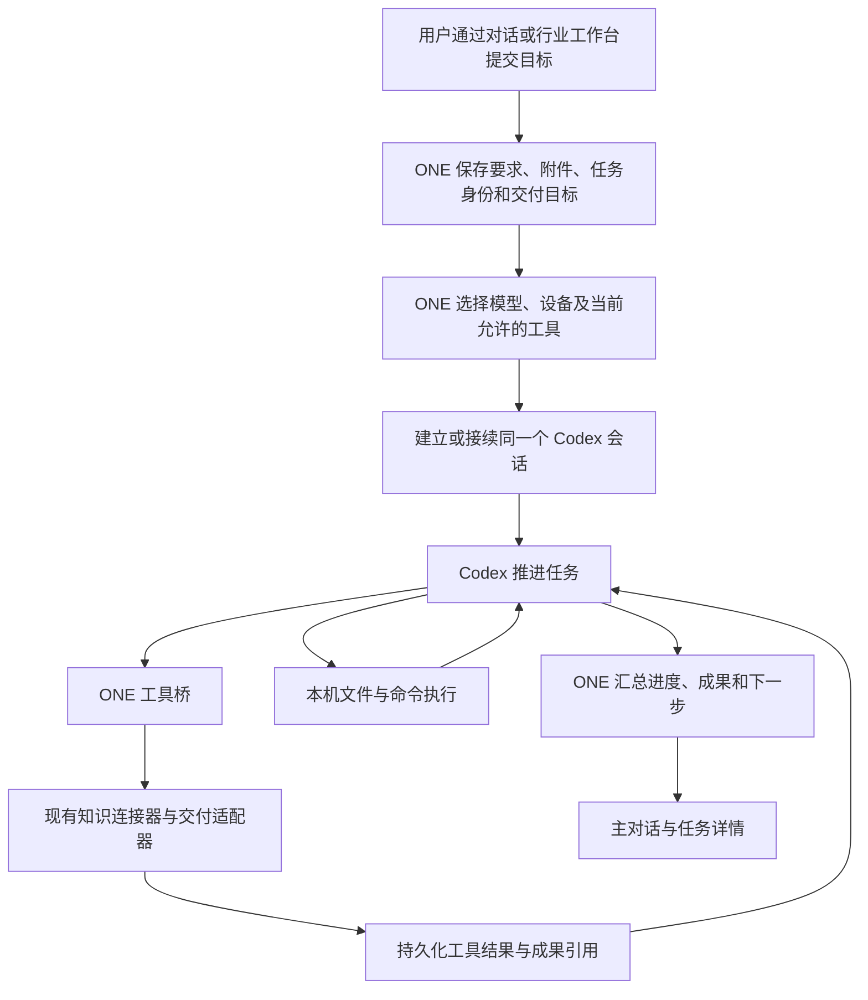

# ONE 以 Codex 为主要执行器的改造计划

日期为 2026-11-17。当前状态为实施中，用户已确认开工。固定版本的动态工具回调、同会话接续和本机合成故障检查已有证据；真实 Key、供应商、连接器和两端完整业务验收仍待执行。开发进度以文末清单及[开发验证记录](testing/2026-11-17-codex-bridge/DEV-VERIFICATION.md)更新。

## 1. 交付目标与第一期范围

用户通过 ONE 登录、准备执行工具、使用模型和提交业务任务。ONE 连接资料平台、提供行业工作台、管理任务与用量。Codex 接收完整任务，在同一会话中持续完成资料读取、内容生成、本地文件处理和获授权的交付操作。

第一期完成以下体验。

- Mac、Windows 均可从 ONE 一键准备 Codex，看到下载、校验、安装和可用状态。
- 任务显示由 Codex 执行，并显示用户可识别的模型名称。
- 用户在 ONE 配置本机访问范围，任务创建时将相应范围落实到 Codex。
- Codex 可以在执行中调用 ONE 提供的知识检索、成果保存和 Notion 草稿交付工具。
- 补充要求、刷新页面和暂时断线后，ONE 能定位原任务、原会话与已完成成果。
- 模型请求继续使用 ONE 网关和实际用量账本。第一批包含已有通过验证的执行模型，以及待验证的 DeepSeek 组合。
- 一个已有行业工作台能够使用上述执行路径，业务配置和成果要求由工作台提供。

后续阶段包括 Claude Code、更多模型组合、主动文件索引、跨应用通知读取，以及按具体企业项目增加的连接器和私有部署配置。

本期的首批执行位置为用户当前连接的电脑。任务界面需要明确运行设备与在线状态。已有云端任务按类型逐步接入新路径，迁移次序与每种任务的离线行为分别验证。

## 2. 已核对的实现基础

代码检查基于 `91d9466e609f1e5c75279ea98a857b7baf407e58`。正式开发前核对届时主分支，并保留用户已有修改。

| 部分 | 当前基础 | 本期需要补齐的内容 |
| --- | --- | --- |
| Mac Codex 安装 | 已有签名工具清单、确认安装、版本及完整性校验、独立配置 | 准备入口与任务入口衔接，公开展示执行器状态 |
| Windows 执行 | 已有驻留程序、Key 连接、目录配置和原生文件工具 | Codex 安装、App Server、会话和回执适配 |
| Codex 模型网关 | 已有 Responses 流式转发、短时执行授权、预算与实际用量结算 | 验证模型组合，补充所需的兼容适配 |
| Codex 本地会话 | 已有 thread、turn、命令和文件事件跟踪、取消及终态回执 | 接入 ONE 工具调用与相应事件 |
| ONE 连接器 | 已有得到大脑检索、Notion 读取与独立授权的草稿写入 | 把现有业务实现提供给精确绑定的 Codex 任务 |
| 任务与恢复 | 已有持久步骤、成果引用、回执、结果通知和恢复检查 | 将 Codex 执行事件接入同一任务记录 |

上述基线版本的 App Server 初始化使用 `experimentalApi=false`，服务端发来的工具或授权请求统一进入拒绝处理。本次实施已新增动态工具接线，并以固定 Codex `0.160.1`、生产控制器和本机合成模型验证回调与新进程恢复。该证据的范围见开发验证记录，真实业务接线按后续阶段验收。

主要代码入口如下。

- `src/LocalDeviceSettings.tsx`
- `launcher/macos/ManagedCodex.swift`
- `launcher/macos/CodexGatewayConfiguration.swift`
- `launcher/macos/CodexAppServer.swift`
- `launcher/macos/ONEKeyLauncher.swift`
- `launcher/windows/main_windows.go`
- `server/codexGateway.ts`
- `server/executionService.ts`
- `server/knowledge/knowledgeService.ts`
- `server/notionDocuments.ts`
- `server/coordinatorService.ts`

实施时复用上述实际业务逻辑，结合当时源码确认函数与数据结构。

## 3. 任务如何运行

### 3.1 执行分工

ONE 在任务开始时提供用户目标、工作台要求、相关上下文、预算、授权范围和工具目录。Codex 负责执行中的具体步骤安排、工具使用、文件处理和调试。

ONE 保存可观察的执行事件和成果。任务动态按这些事件更新，主对话汇报成果或需要用户补充的具体事项。一个业务任务持续绑定同一执行会话，用户的后续补充进入该任务。

行业工作台把业务规则、资料来源、模板和交付要求编译进任务输入。阶段 5 选择一个已有工作台验证复用。

### 3.2 ONE 工具桥

第一批工具覆盖知识检索、完整成果登记、Notion 草稿保存，以及已有交付结果查询。工具名和输入结构尽量沿用当前实现，在阶段 1 确认传输方式后定稿。

每次调用绑定已有任务的工作区、用户、设备、安装身份、执行轮次和调用编号。服务端根据当前绑定确定连接器与保存目标，检查相应来源和目的地权限。模型和本机执行器取得任务所需的工具结果，供应商与知识平台凭据由 ONE 服务端管理。

知识结果保留正文、来源、日期、截断和检索覆盖信息。任务原话、附件和成果通过精确引用接续，调用上下文按需读取。

工具调用在实际执行前保存调用编号、输入摘要和状态。已完成的重复调用返回原结果，仍在执行的调用关联原操作等待或查询。同一调用编号收到不同输入时，返回绑定冲突并保留原操作。交付未知的调用按原记录查询实际结果。连接器重试、执行器恢复与模型请求恢复共同使用已有调用记录和预算约束。

临时读取故障和可证明未受理的调用复用既有有限自动恢复策略，保存恢复次数、原因和下一次时间。确实需要用户补充资料、恢复授权或作出决定时，通过原任务提出具体事项。

### 3.3 成果与完成

文章等可移植正文先登记为 ONE 完整成果。外部保存使用该成果引用和准确目标，成功业务回执完成相应交付。后台完整性检查沿用现行外部交付契约。

本机文件保存完整路径、类型及可取得的实际验证证据。ONE 展示文件入口，并按照任务要求检查关键字段、文件可读性或页面交互。

模型的完成消息、工具执行事实、成果交付和用户通知分别记录。断线后按原任务、会话和工具调用编号恢复进度。需要补充时，在主对话提出具体问题，用户回复进入原任务并继续执行。

## 4. 分阶段实施与验收

### 阶段 0. 固定对照任务与当前结果

选用独立合成资料建立下表中的对照任务。已有路径能够完成的任务记录实际结果，已有路径失败的任务保留具体失败位置。每次记录任务要求、输入资料摘要、模型及执行器版本、成果、人工介入和实际用量。

| 编号 | 对照任务 | 核对重点 |
| --- | --- | --- |
| A | 根据图片模板生成 Excel，再在同一任务中修改一个字段 | 附件传递、实际文件、字段正确、同任务修改 |
| B | 查找已授权得到大脑笔记，写文章并保存到授权 Notion 位置 | 资料实际引用、完整原稿、准确页面与成功回执 |
| C | 先生成短文，下一轮补充保存到 Notion | 原稿复用、渠道补充、保存次数 |
| D | 修改独立网页项目的背景色，再修改一段文字 | 项目定位、目录复用、实际变更和浏览器展示 |
| E | 运行中补充要求、暂时断线、刷新后继续 | 原任务接续、已完成成果保留、恢复行为 |

**验收产物**为可复现的输入、旧路径结果与指标表。真实用户任务采用已有证据或获准的诊断记录，新执行使用独立测试任务和目标。

### 阶段 1. 验证 Codex 调用 ONE 工具

使用固定 Codex 版本和隔离任务，完成一次读取合成资料、调用合成保存工具、接收保存回执并结束任务的完整往返。

优先验证现有 App Server 的动态工具回调。根据固定版本实测结果，在动态工具与 ONE STDIO MCP 代理中确定一条生产接入路径。若需要升级 Codex，记录所需版本、变更面和回归结果。

**验收标准**

- 同一 thread 和 turn 能收到工具结果并继续。
- ONE 能确认每次工具调用属于准确的任务与执行轮次。
- 重复调用编号返回相同的已保存结果，实际保存次数为一次。
- 合成保存已生效、返回工具结果前断开连接，恢复原 thread 后取得同一回执，实际保存次数仍为一次。
- 停止、超时和工具错误能回到 ONE 的任务记录，并保留准确原因。
- 开发记录确定工具传输、固定版本及恢复方式。

### 阶段 2. 接入真实资料与交付

将阶段 1 的工具桥接到现有知识服务、完整成果保存和 Notion 草稿交付实现，跑通对照任务 B、C。

现有 Notion 工具依赖 `chatOperation`、`WorkRun` 和 `notionTarget`，执行前检查任务处于运行状态。新桥梁任务复用这些记录作为工具调用所有者，由 ONE 持久保存调用与交付回执，Codex 负责继续执行。

**验收标准**

- 能取得指定授权来源的实际内容，文章可追溯所用资料。
- 完整正文可从 ONE 取回，Notion 页面有本次交付回执和准确入口。
- 平台增加标题、日期或等价格式后，已确认保存仍显示完成。
- 用户下一轮补充保存要求时，原文得到复用，保存操作有准确归属。
- 已保存后回执暂时丢失，恢复查询定位原操作，页面新建次数保持一次。
- 来源撤销、目的地失效和跨工作区请求得到明确反馈，已有成果可查看。

### 阶段 3. 统一 Mac、Windows 安装与本机执行

复用 Mac 现有工具准备流程，在 Windows 补齐 Codex 安装、独立配置、App Server、进度和回执适配。将 ONE 保存的目录范围落实到实际执行配置，验证任务 A、D。

两端共享业务协议和验收用例，分别实现进程、目录与系统权限处理。工具更新沿用签名清单、完整性校验和可用旧版本恢复。

**验收标准**

- 用户从 ONE 一键准备，成功后直接提交本机任务。
- 工具来源、执行器和对外模型名称可查看。
- 同一授权范围内连续任务、应用重启和工具升级后能够复用目录配置。
- 可读、可写范围由实际执行策略和系统权限落实，验证目录边界、符号链接以及换目录后的会话绑定。
- Excel 实际可打开，关键字段和修改结果符合要求。
- 网页项目变更可回读，页面真实显示预期结果。
- Mac、Windows 各自完成安装、运行、停止和恢复真机验收。

### 阶段 4. 任务接续与结果展示

将执行事件接到现有任务动态、任务详情和结果通知。补充、继续、停止与恢复使用同一任务入口和执行身份，覆盖任务 E。

**验收标准**

- 用户知道任务正在做什么、已有何成果，以及是否需要自己处理。
- 本机任务进行中和等待补充时，页面执行主题按任务生命周期保持连续。
- 信息补齐后，已获准的原任务能够继续，处理链路自动推进。
- 刷新、窗口切换、断线和启动器恢复后，原任务及成果仍可定位。
- 已完成工具结果得到复用，恢复过程中的写入和用量可以核对。
- 用户停止后任务进入准确状态，晚到事件保留原归属。
- 相同终态多次到达，主对话的完成通知只生成一次。
- 错误反馈给出具体环节、已完成部分、自动恢复状态和可操作下一步。

### 阶段 5. 多模型与行业工作台试点

先验证已有执行模型，再增加 DeepSeek 的 Codex 组合。支持名称与配置以真实验证结果发布。ONE 模型网关承担路由、兼容适配与用量归属。

选择一个已有行业工作台，使用现有资料来源和模板，把业务要求交给同一 Codex 执行路径。优先选能复用图片、表格或文章交付用例的入口，试点名称在阶段 0 固定。

**验收标准**

- 每个发布组合按声明的输入与任务类型，验证工具调用、结果返回和原任务接续。图片任务由支持视觉输入的模型或获准的图片解析工具处理。
- 逐次模型调用有实际用量、价格快照和所属任务，未知用量按现有账本流程处理。
- 工作台提交得到完整交付，来源、业务要求和成果格式均符合配置。
- 新旧方案对照记录首次成功率、总耗时、实际电力、人工介入次数及恢复成功率。
- 首批完整执行路径覆盖 A 至 E，各模型组合执行其声明支持的对应任务。随机性明显的重点任务增加重复次数，并在报告中列明样本量。

### 阶段 6. 发布与扩大使用

先供内部合成任务使用，再向少量明确的体验账号开放。按任务类型记录执行路线，持续核对版本与结果。已运行任务继续依照自身固定的执行器、模型和交付记录恢复。

**验收标准**

- TypeScript、相关单元与集成测试、新数据路径隔离测试、生产构建和差异检查通过。
- 应用、Mac、Windows 的发布检查通过，实际运行的版本可以确认。
- 新版在两端完成 A 至 E 的真机证据，所有已开放任务类型具有可用成果。
- 重复创建文件或外部页面、重复结算、跨工作区访问和完成状态回退的验收用例均通过。
- 旧任务、旧会话和旧成果仍能按其记录查看与恢复。
- 出现问题时可停止向新任务分配新路径，已有任务与成果按原身份继续处理。

## 5. 指标与完成判断

| 指标 | 记录口径 |
| --- | --- |
| 首次成功 | 首次提交后，达到用户指定的可交付结果 |
| 总耗时 | ONE 受理至取得可用成果，包含安装或等待时另行标明 |
| 实际电力 | 该任务全部调度、执行及恢复调用的真实结算记录 |
| 用户介入 | 提供必要资料、授权、决策以及手动重试分别计数 |
| 恢复成功 | 出现中断后，保留原任务和成果并最终完成 |
| 重复副作用 | 额外文件、重复页面、重复写入及重复结算分别核对 |
| 完成一致性 | 实际成果、任务状态、主对话反馈及刷新后状态一致 |

先根据阶段 0 记录取得可比较的基线。完成率和介入次数作为主要改进指标，耗时和电力同时展示。对照中使用相同输入及交付要求，区分执行架构变化与模型变化带来的差异。

阶段验收记录预期、实际结果、源码版本、执行器版本、模型、任务编号和成果证据。模拟、真实模型、连接器、浏览器和实体机验证分别注明其覆盖范围。

## 6. 与现有文档和实现衔接

| 现有文档 | 本期衔接方式 |
| --- | --- |
| [本机执行闭环与设备准备](本机执行闭环与设备准备-2026-10-07.md) | 复用 Codex 安装、独立配置、网关和回执。新方案采用公开可见的执行器状态与名称，安装与首次使用入口按本计划实施 |
| [逐步工作流](ONE-STEP-WORKFLOWS-20261025.md) | 现有任务继续使用自己的工作流记录。新桥梁任务将执行编排交给 Codex，ONE 记录实际工具事件和交付状态 |
| [持久成果驱动的交付](DURABLE-TASK-DELIVERY-20261103.md) | 复用成果引用、恢复记录和结果通知。已生成内容与成功交付证据继续用于接续 |
| [外部接口交付契约](EXTERNAL-DELIVERY-CONTRACT-20261110.md) | 完整 ONE 成果、外部成功回执、后台覆盖检查继续依照现行契约处理 |
| [架构文档](ARCHITECTURE.md)与[开发执行清单](ONE-PROJECT-EXECUTION-CHECKLIST.md) | 在对应阶段实际实现后补充生效范围、版本、迁移规则及验收入口 |

本计划描述本次演进方向。已有文档中的历史实现与验收记录保留其日期和范围，正式合入实现时更新相关文档的当前规则。

## 7. 开发进度

- [x] 确认 Codex 为第一期主要执行器。
- [x] 核对现有安装、网关、会话、连接器和恢复实现。
- [x] 形成分阶段计划与验收标准。
- [x] 固定 A 至 E 的合成对照输入和统计模板。
- [ ] 执行旧路径对照并确定真实试点工作台。
- [x] 验证固定 `0.160.1` 的动态工具回调及新进程原 thread 接续，确定首期工具传输。
- [ ] 完成同一 Codex 会话的资料读取、成果生成和 Notion 交付。
- [ ] 补齐 Windows，完成两端本机任务。
- [ ] 完成任务接续、进度和恢复体验。
- [ ] 验证 DeepSeek 及已有工作台试点。
- [ ] 完成真实对照、发布和小范围使用验收。

### 当前交付边界

源码已经接入 ONE 动态工具、同线程恢复、持久回执、Mac 严格目录权限、公开准备入口，以及 Windows 安装与原生进程适配。开发验证记录保存每项证据；这些实现不代替上面尚未勾选的真实验收。

Windows 固定 `0.160.1` 的官方实包安装、重建和篡改拒绝已通过。CI 宿主缺少 MXC；同版本 `elevated` 又拒绝根目录默认禁止读取的策略。因此 Windows 新桥梁版本矩阵暂为空，保持原内置文件工具可用，不把协议或安装测试当作严格隔离验收。本期 Windows 目标仍保留，阶段 3 尚未完成；须在支持的实体系统上通过原定边界与业务检查后再开放。

用户已说明 ONE Key 稍后恢复。真实供应商、连接器、A 至 E 新旧对照、DeepSeek 组合与实际电力保持待验收，不填写估算成功率或节省比例。开发分支上的自动检查不部署生产；主干、线上路由及公开启动器清单须在真实验收通过后再切换。

## 8. 已核对的官方依据

- [Codex App Server](https://learn.chatgpt.com/docs/app-server) 提供线程、执行轮次、事件与动态工具回调。动态工具属于实验接口，固定版本实测结果决定阶段 1 的接入方式。
- [Codex MCP](https://learn.chatgpt.com/docs/extend/mcp?surface=cli) 提供 MCP 工具接入方式，可用于 ONE 工具代理。
- [DeepSeek 接入 Codex](https://api-docs.deepseek.com/quick_start/agent_integrations/codex/) 提供原生 Responses 兼容接入说明，作为阶段 5 的验证依据。

以上文档在 2026-11-17 查阅。实施时以所采用的实际版本、模型服务和平台行为验证。
